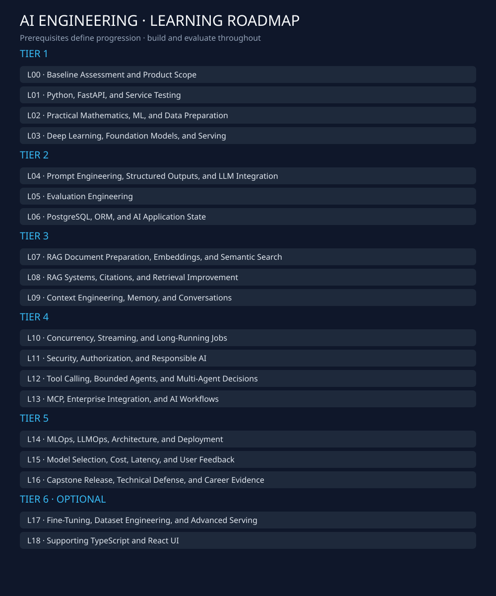
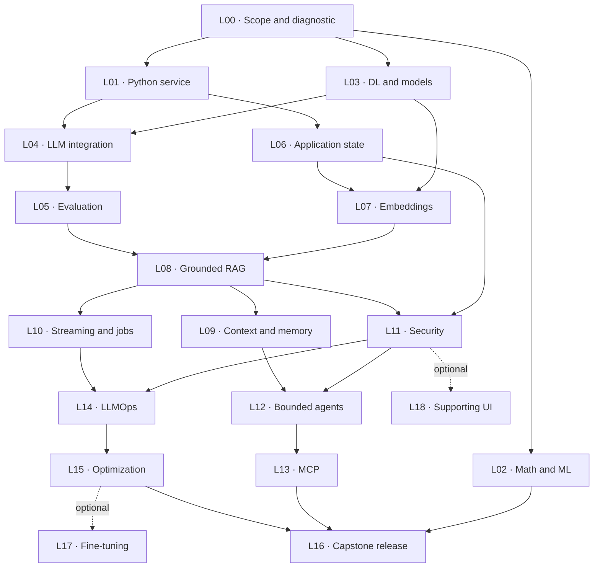

# AI Engineering Roadmap

**Build, evaluate, and operate grounded AI applications — 6 tiers, 19 prerequisite-based Levels.**

Designed for Abdelrahman’s Node.js/Express backend experience, Python fundamentals, and SQL background. Based on the official ITI Native AI Developer syllabus, three selected AI Engineering books, and Anthropic’s Context Engineering article. Independent study guide; not affiliated with or endorsed by ITI.

[Start here](START_HERE.md) · [Coverage matrix](docs/ITI_COVERAGE.md) · [Book reading order](docs/READING_GUIDE.md) · [Chapter lookup](docs/CHAPTER_MAP.md) · [Capstone](project/README.md) · [Progress](progress/PROGRESS.md) · [Sources](docs/SOURCES.md)

## How the repository works

| File | Purpose |
| --- | --- |
| Each numbered Level/README.md | The ordered learning journey: one primary resource, exact reading, task and completion check per step. |
| Each numbered Level/resources.md | Topic-grouped Arabic/English resource tables with explicit choices, complementary sequences and reference notes. |
| Each numbered Level/details.md | Diagnostics, complete technical scope, debugging guidance, self-check answers and ITI provenance. |
| curriculum.json | Machine-readable Levels, dependencies, hours, ITI mapping, and exercises. |
| progress/tracker.csv | Your status, evidence, and diagnostic waivers; generated dashboard in PROGRESS.md. |
| project/milestones | Eight incremental acceptance contracts for one capstone. |

## Reading the roadmap

| Label | Meaning |
| --- | --- |
| ITI N01–N32 | Local identifiers for exact titles from the published Native AI Developer brochure. |
| Industry extension | Specific tools and operational depth added by this roadmap; not an official ITI requirement. |
| Difficulty 1–5 | Relative learning complexity: introductory → advanced applied work; not seniority. |
| Personal hours | Focused learning plus assigned implementation; not ITI classroom hours and not a guarantee. |
| P0 / P1 / P2 / P3 | Essential now / first complete project / production quality / advanced or optional. |

## Topic-level learning resources

Open a Level and follow **Start Here / Recommended Learning Path**. Every numbered step connects the topic → assigned book slice → one Primary resource → practical task → completion check. Consult `details.md` for diagnostics and technical reference; open `resources.md` only when you need an alternative or implementation reference.

The complete Arabic/Egyptian and English libraries are preserved. Resource Type distinguishes a single video, playlist, full/short course, documentation, book section and lab. Within each topic group, study rules distinguish **choose ONE explanation**, **study A THEN B**, and **consult C while implementing**. You do not need to complete every listed resource.

[Topic-table audit](docs/RESOURCE_TABLE_AUDIT.md) · [Learning-experience audit](docs/LEARNING_EXPERIENCE_AUDIT.md) · [Resource policy](docs/RESOURCE_POLICY.md) · [All-Level coverage audit](docs/RESOURCE_AUDIT.md) · [Reference comparison](docs/REFERENCE_COMPARISON.md)

Choose one explanation per gap and build. The expanded library contains alternatives; it does not increase the required path to every listed course.

## Your starting advantage

| Already practiced | Review quickly | Learn deliberately |
| --- | --- | --- |
| Express REST, middleware, validation, JWT/RBAC, Jest/Supertest | Pass L00 diagnostic and map concepts to Python | Typing versus runtime validation; Pydantic, dependency lifecycle, pytest fixtures. |
| Python syntax/OOP and SQL concepts | Skip a full beginner course after diagnostic evidence | Async I/O, SQLAlchemy sessions, migrations, cancellation, ownership-aware retrieval. |
| Git and Docker basics | Demonstrate a clean setup and container build | Evaluation gates, prompt/data versions, traces, secrets, rollback. |

## The complete roadmap

Follow prerequisites, not a weekly calendar. Build from L01; do not wait to finish all reading. Foundations L02/L03 are bounded labs, not a Data Science specialization.

### Tier 1 · Engineering and Model Foundations

| Level | ITI mapping | Focus / output | Difficulty | Prerequisites | Personal time |
| --- | --- | --- | --- | --- | --- |
| [L00 · Baseline Assessment and Product Scope](00-Orientation/README.md) | N01, N03, N09, N30, N31 | Identify transferable backend skills and specific gaps. Define users, requirements, failure cases, and acceptance evidence. | 1/5 | Diagnostic | 3–5 h |
| [L01 · Python, FastAPI, and Service Testing](01-Python-FastAPI/README.md) | N02, N05, N07 | Use type hints, Pydantic, dependency injection, and lifespan management. Separate HTTP handlers from application logic and test the service. | 2/5 | L00 | 14–20 h |
| [L02 · Practical Mathematics, ML, and Data Preparation](02-Mathematics-ML/README.md) | N11, N12, N13 | Understand vectors, matrices, similarity, probability, loss, and gradients through small examples. Run an ML baseline with correct splits, preprocessing, and evaluation. Recognize leakage and distinguish a similarity score from a calibrated probability. | 2/5 | L00 | 16–24 h |
| [L03 · Deep Learning, Foundation Models, and Serving](03-Deep-Learning-Foundation-Models/README.md) | N14, N15, N16 | Distinguish pretraining, supervised fine-tuning, preference tuning, and inference. Understand layers, autograd, attention, tokenization, sampling, and resource constraints. Choose an external provider or local inference endpoint with a reasoned boundary. | 3/5 | L00 | 12–18 h |

### Tier 2 · Reliable LLM Application Basics

| Level | ITI mapping | Focus / output | Difficulty | Prerequisites | Personal time |
| --- | --- | --- | --- | --- | --- |
| [L04 · Prompt Engineering, Structured Outputs, and LLM Integration](04-LLM-Applications-Prompts/README.md) | N04, N16 | Design instructions, examples, schemas, and untrusted-input boundaries. Integrate one model behind an adapter with controlled error handling. | 2/5 | L01, L03 | 10–16 h |
| [L05 · Evaluation Engineering](05-Evaluation/README.md) | N05, N20 | Define datasets and rubrics before expanding the application. Distinguish deterministic tests, component evaluation, and end-to-end quality. | 3/5 | L04 | 14–22 h |
| [L06 · PostgreSQL, ORM, and AI Application State](06-Application-State/README.md) | N06, N07, N09 | Move from Mongoose-style ODM experience to SQLAlchemy relations, sessions, transactions, and Alembic. Design document, conversation, and journal ownership and versions. | 2/5 | L01 | 12–18 h |

### Tier 3 · Grounded Retrieval and Context

| Level | ITI mapping | Focus / output | Difficulty | Prerequisites | Personal time |
| --- | --- | --- | --- | --- | --- |
| [L07 · RAG Document Preparation, Embeddings, and Semantic Search](07-Embeddings-Semantic-Search/README.md) | N12, N17, N19 | Convert a small textual PDF into traceable chunks with page provenance. Compare a lexical baseline with embeddings appropriate to the application language. | 3/5 | L03, L06 | 16–24 h |
| [L08 · RAG Systems, Citations, and Retrieval Improvement](08-RAG-Systems/README.md) | N17, N19, N20 | Build retrieval → context → generation with verifiable citations. Diagnose failures and justify hybrid search or reranking through comparison. | 3/5 | L05, L07 | 18–28 h |
| [L09 · Context Engineering, Memory, and Conversations](09-Context-Memory/README.md) | N04, N19, N22 | Budget instructions, evidence, selected journals, history, and memory. Manage memory provenance, correction, deletion, and summarization loss. | 3/5 | L08 | 14–22 h |

### Tier 4 · Production Behavior and Tool Use

| Level | ITI mapping | Focus / output | Difficulty | Prerequisites | Personal time |
| --- | --- | --- | --- | --- | --- |
| [L10 · Concurrency, Streaming, and Long-Running Jobs](10-Concurrency-Streaming-Jobs/README.md) | N02, N18, N25 | Separate I/O concurrency from CPU parallelism and avoid blocking the event loop. Handle streaming cancellation, timeouts, and restartable ingestion jobs. | 3/5 | L08 | 16–24 h |
| [L11 · Security, Authorization, and Responsible AI](11-Security-Responsible-AI/README.md) | N07, N20, N26 | Enforce ownership before retrieval, source viewing, history, memory, and job access. Constrain untrusted content, tools, uploads, and consumption. | 3/5 | L06, L08 | 16–24 h |
| [L12 · Tool Calling, Bounded Agents, and Multi-Agent Decisions](12-Tools-Agents/README.md) | N20, N22, N24 | Distinguish fixed workflows from model-directed tool loops. Implement safe tool contracts and evaluate tool/task failures. Understand sub-agent patterns without assuming they improve the product. | 4/5 | L05, L09, L11 | 18–28 h |
| [L13 · MCP, Enterprise Integration, and AI Workflows](13-MCP-Enterprise-Integration/README.md) | N23, N24 | Understand MCP host/client/server roles, primitives, transport, and authorization. Build one bounded integration with explicit failure behavior. | 3/5 | L12 | 10–16 h |

### Tier 5 · Operating and Demonstrating AI Systems

| Level | ITI mapping | Focus / output | Difficulty | Prerequisites | Personal time |
| --- | --- | --- | --- | --- | --- |
| [L14 · MLOps, LLMOps, Architecture, and Deployment](14-LLMOps-Deployment/README.md) | N01, N05, N09, N10, N15, N25 | Version model/prompt/corpus/evaluation artifacts and trace execution. Release, restore, and diagnose an AI service and its worker. | 4/5 | L10, L11 | 20–30 h |
| [L15 · Model Selection, Cost, Latency, and User Feedback](15-Model-Selection-Optimization/README.md) | N20, N25 | Improve a measured bottleneck without sacrificing quality or isolation. Interpret user feedback as a signal rather than unquestioned labels. | 4/5 | L05, L14 | 12–18 h |
| [L16 · Capstone Release, Technical Defense, and Career Evidence](16-Capstone-Career/README.md) | N27, N28, N29, N30, N31, N32 | Demonstrate a usable AI application with evaluation and operating evidence. Explain and modify the implementation independently and communicate honest limitations. | 4/5 | L02, L03, L08, L09, L10, L11, L12, L13, L14, L15 | 12–18 h |

### Tier 6 · Optional Specialization and Supporting UI

| Level | ITI mapping | Focus / output | Difficulty | Prerequisites | Personal time |
| --- | --- | --- | --- | --- | --- |
| [L17 · Fine-Tuning, Dataset Engineering, and Advanced Serving](17-Fine-Tuning-Advanced-Serving/README.md) | N12, N15, N21 | Choose between prompt changes, RAG, model selection, and fine-tuning using failure evidence. Understand SFT/LoRA, curation, quantization, and serving tradeoffs. | 4/5 | L02, L03, L05, L15 | 18–32 h |
| [L18 · Supporting TypeScript and React UI](18-Supporting-Frontend/README.md) | N05, N08 | Build a small accessible client for API errors, streaming, and evidence display. Distinguish product UI needs from a complete React/TypeScript curriculum. | 2/5 | L01, L04, L11 | 12–20 h |



## Learning progression



This compact graph shows the main branches; the Level tables and manifest are the full prerequisite contract. L12 additionally depends on L05; L16 consolidates all core gates.

## Pick a sustainable pace

Core path: **233–355 focused hours**. Level estimates already include their assigned capstone work; do not add milestone hours again. Optional Levels are separate. Allow contingency for debugging and prior gaps.

| Hours/week | Core estimate before contingency | How to adapt |
| --- | --- | --- |
| 8–10 | 23–44 weeks | Finish one small gate at a time; keep the corpus and provider count small. |
| 15–20 | 12–24 weeks | Default pace: about 60% implementation, 25% reading, 15% evaluation and notes. |
| 25–30 | 8–14 weeks | Use extra time for tests and failure analysis before adding frameworks. |

## One capstone, built incrementally

Book-Grounded Reflection Assistant: a FastAPI service that retrieves permitted source passages, cites evidence, connects user-selected journal entries, and manages bounded context. It is a reflection/productivity tool; outputs distinguish source claims from suggestions.

| Stage | Deliverable | Level checkpoint |
| --- | --- | --- |
| [S0](project/milestones/s0.md) | Scope and Baseline | L00 |
| [S1](project/milestones/s1.md) | Testable Python API | L00, L01 |
| [S2](project/milestones/s2.md) | LLM Integration and Scientific Foundations | L01, L02, L03, L04 |
| [S3](project/milestones/s3.md) | Measured RAG MVP | L05, L06, L07, L08 |
| [S4](project/milestones/s4.md) | Safe Context-Aware Product | L09, L10, L11 |
| [S5](project/milestones/s5.md) | Tools, Agents, and MCP | L12, L13 |
| [S6](project/milestones/s6.md) | Operations and Optimization | L14, L15 |
| [S7](project/milestones/s7.md) | Portfolio Release and Technical Defense | L16 |

## Progress and completion

```bash
python scripts/progress.py next
python scripts/progress.py set L00 in_progress
python scripts/progress.py set L00 completed --evidence "evidence/baseline.md"
python scripts/validate.py
python -m unittest discover -s tests -v
```

[Progress instructions](progress/README.md) explain evidence and waiver requirements. Reading a chapter is not completion: show working behavior, relevant tests, and a decision you can explain without generated code.

## Scope decisions

| Essential | Add only when justified | Defer |
| --- | --- | --- |
| FastAPI, one model adapter, PostgreSQL/pgvector, evaluation fixtures | Hybrid search, reranking, persistent jobs, bounded tools, MCP | Multi-agent systems, fine-tuning, GPU optimization, orchestration frameworks. |
| ML/DL concepts through small CPU labs | Extra architecture depth after measured failures | Research-level derivations, large training runs, Data Engineering specialization. |

## Sources, coverage, and limitations

The [coverage matrix](docs/ITI_COVERAGE.md) maps every published syllabus row to Levels and evidence. Representation is not mastery. Optional frontend and fine-tuning material remains visible because ITI names it, while the core path prioritizes practical AI systems. The brochure advertises 678 hours while its listed rows sum to 696; that discrepancy is retained without inventing a correction.

The supplied book contents and relevant sections were checked in the existing research. [Sources and pagination](docs/SOURCES.md) explain exact editions, verification boundaries, and resource links. Current provider prices and interview questions are not asserted.

## Repository structure and quality

[Repository guide](docs/REPOSITORY_GUIDE.md) · [Evaluation](docs/EVALUATION.md) · [Security](docs/SECURITY.md) · [Context Engineering](docs/CONTEXT_ENGINEERING.md) · [Career evidence](docs/CAREER.md) · [Learning with AI](docs/LEARNING_WITH_AI.md)

Organizational inspiration: [Data Engineering Roadmap 2026](https://github.com/Yahiasherif002/Data-Engineering-Roadmap-2026). Its tier/Level navigation and topic-to-resource approach informed this rebuild; its subjects, hours, level count, and text were not copied.

**Start with [L00](00-Orientation/README.md), then build the first tested endpoint in [L01](01-Python-FastAPI/README.md).**
