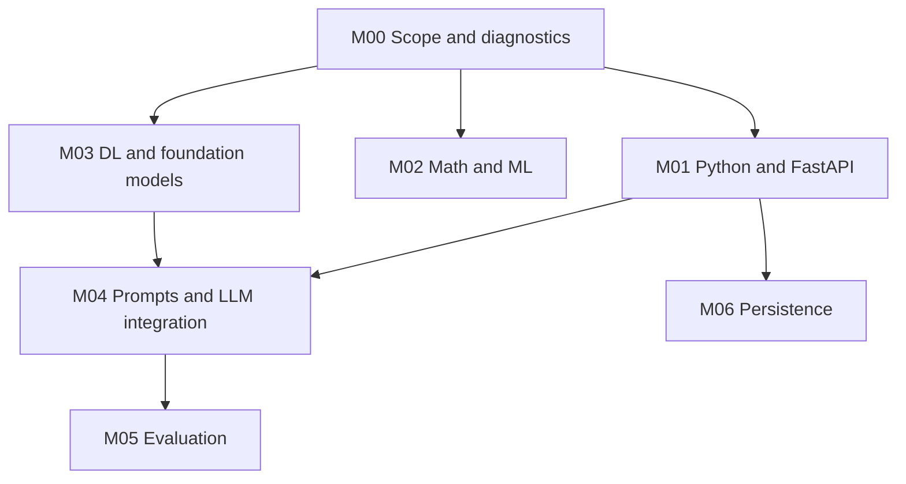
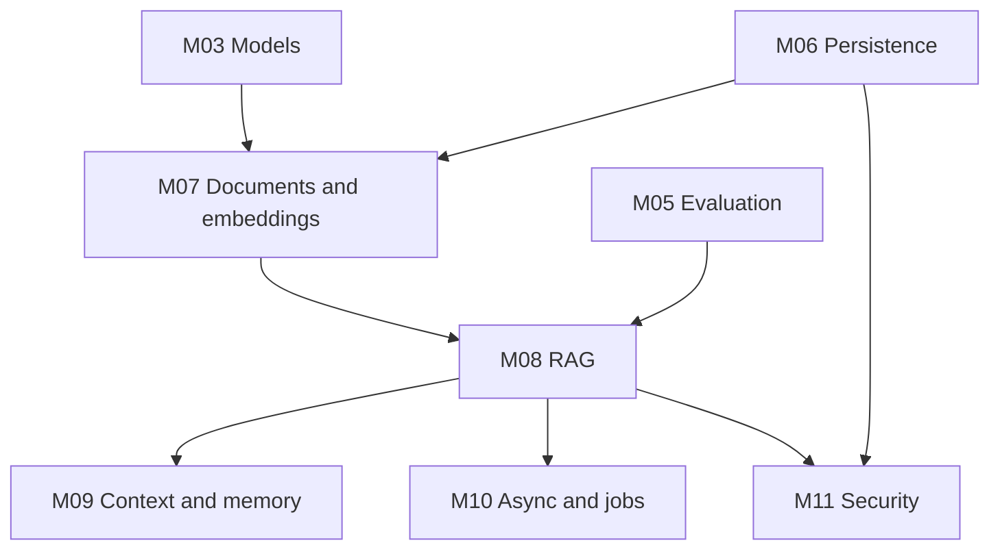
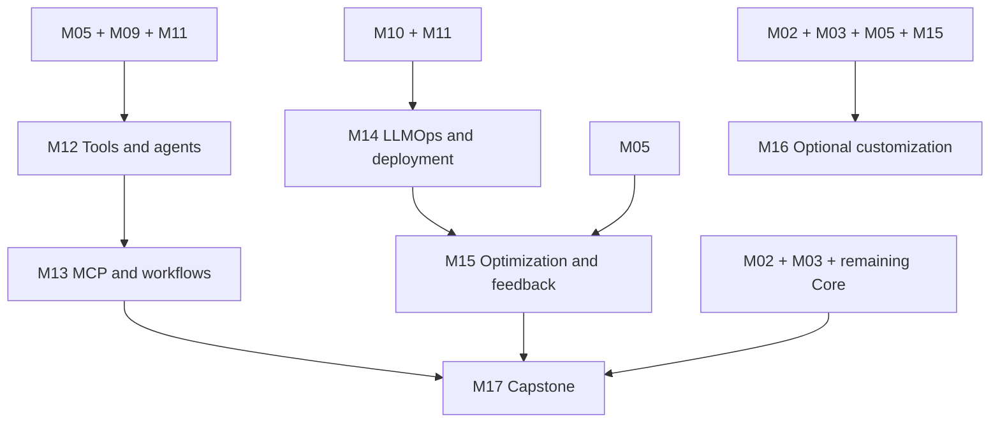

# Prerequisite Roadmap

[Home](../README.md) · [Manifest](../curriculum.json) · [Progress](../progress/README.md)

The SVG presents learning stages. The graphs and manifest define exact dependencies; arrows mean hard prerequisites. Numbers do not force independent modules to wait.

## Foundation path

M02 progresses alongside implementation and remains required for Core. M03 needs basic vector intuition; use M02-E1 if needed without blocking the first API on an entire ML course.

## Grounded and reliable application

## Agents, operations, and optional depth

Grouped nodes abbreviate dependencies. M17’s file lists all required modules. M18 needs M01/M04/M11 and remains optional; a basic product UI is still required.

| Gate | Rule |
|---|---|
| Before RAG | Establish evaluation labels and criteria in M05 |
| Before public access or tools | Pass M11 authorization and isolation tests |
| Before complexity | Justify agents, multiple agents, fine-tuning, and frameworks against a baseline |
| Core completion | Complete M17 and its prerequisites; M16/M18 have separate progress |
| Project delivery | Follow [S0–S7](../project/README.md); agent and operations branches may proceed independently after their gates |
