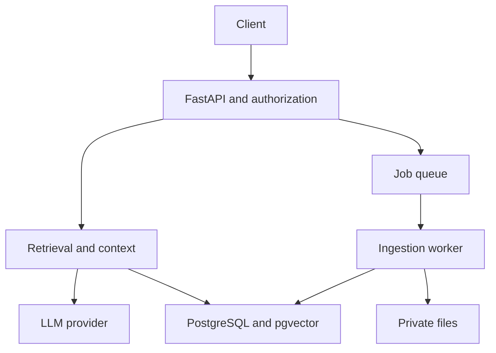

# Initial Architecture Decisions

[Project](README.md) · [ADR template](../templates/ADR.md)

| Component | Initial choice | Reason |
|---|---|---|
| API | FastAPI and Pydantic | Transfer backend knowledge with typed contracts |
| State | PostgreSQL, SQLAlchemy, Alembic | Relations, ownership, transactions, and migrations |
| Retrieval | pgvector | One database to start; exact retrieval before measured ANN need |
| Models | One direct-SDK provider adapter | Keep integration inspectable and testable |
| Files | Private local storage, then persistent volume/object storage | Preserve source access and deployment state |
| Jobs | One worker/queue when necessary | Isolate long-running work and test retry semantics |
| Architecture | Modular monolith | Avoid premature service boundaries |

| Contract | Required behavior |
|---|---|
| Authorization | Scope retrieval and source access before content enters context |
| Citations | Model references come from a whitelist; the server validates IDs and displays source metadata |
| Ownership | The model cannot choose an authoritative user_id or execute arbitrary SQL |
| Provenance | Save document/page/offset/hash/chunker/model/dimension/version/status |
| Sessions | API and concurrent worker tasks do not share one mutable session |
| Memory | Preserve source/date/owner and support edit/delete |
| Search | Exact nearest-neighbor search is not a guarantee of relevant evidence; model dimensions are not guessed from generation-model hidden size |

Initial entities: users, documents, document_versions, chunks, ingestion_runs, conversations, messages, and journal_entries. Record actual alternatives in ADRs rather than treating these recommendations as official ITI tools.
